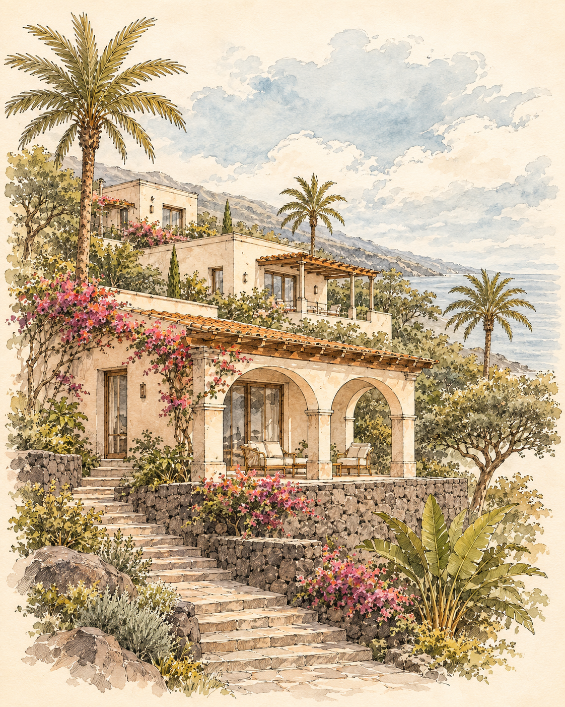
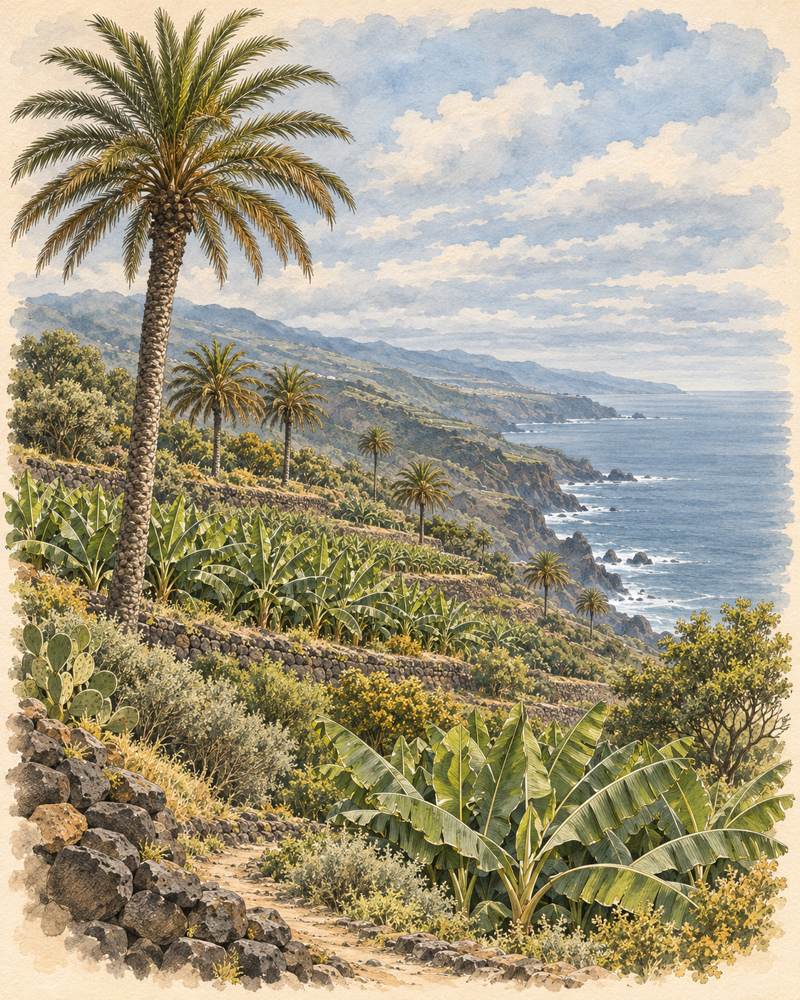
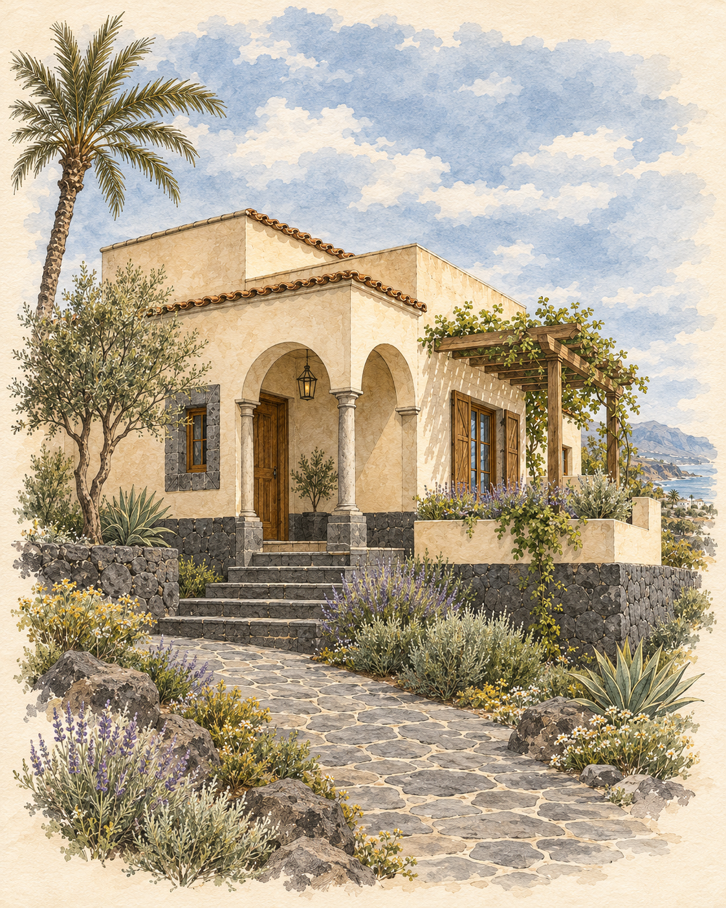
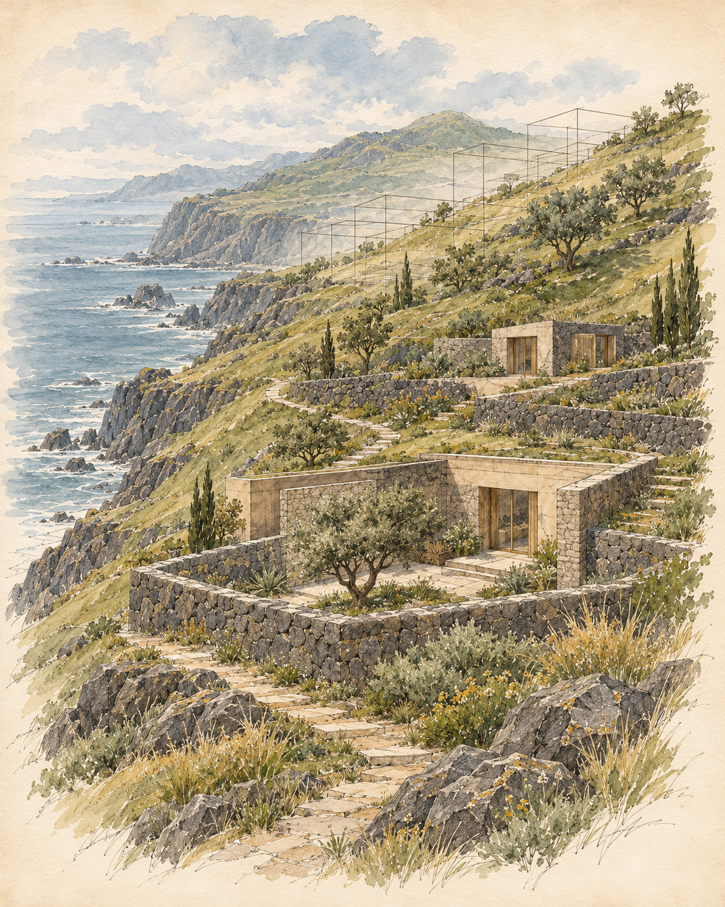
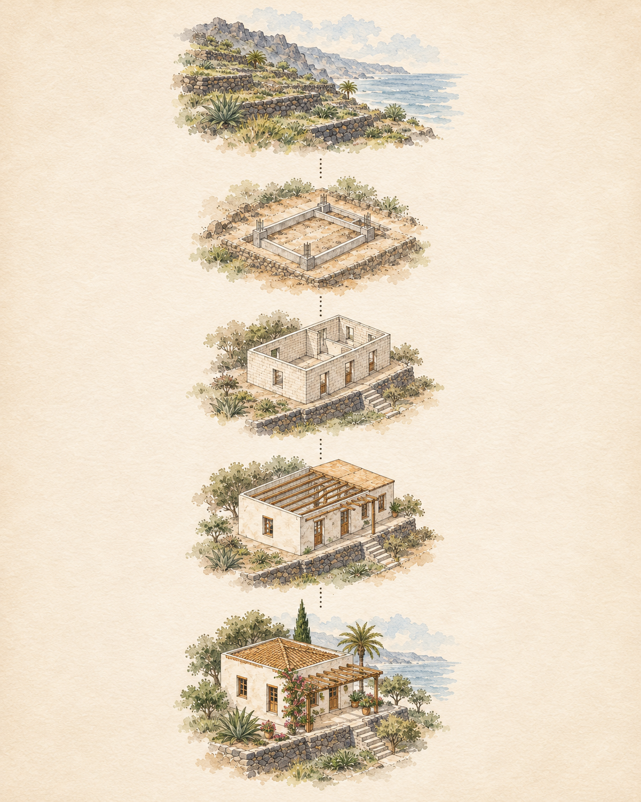

# P0 — approved artwork and independent mobile compositions

Owner approved the five named desktop illustrations on 2026-11-05 and authorized adaptation and preview placement. This approval does not approve an architectural design or production release.

Each portrait is a new vertical composition. Old ART01 mobile crops are retained for history and are no longer selected. Captions remain image-specific in EN/ES/DE/FR/RU.

| Page / frame | Approved desktop | Independent mobile adaptation |
|---|---|---|
| index/F01 |  |  |
| norte/F21 |  |  |
| producto/F05 |  |  |
| inversores/F14 |  |  |
| construccion/F15 |  |  |

The preview selects the five images once each. The ordinary build retains its original imagery and cannot use these assets through a production override without a separate release authorization.

The owner rejected the concurrent EN-only rewrite as erroneous. PR #39 restores the original five-language site while preserving independent CRM and mail commits.

Current tests: 607 discovered, 589 successful, 18 skipped. Placement and responsive evidence are recorded in the execution journal.
