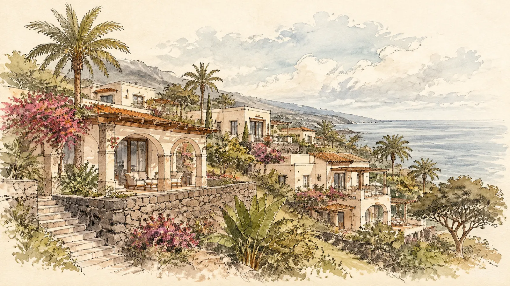
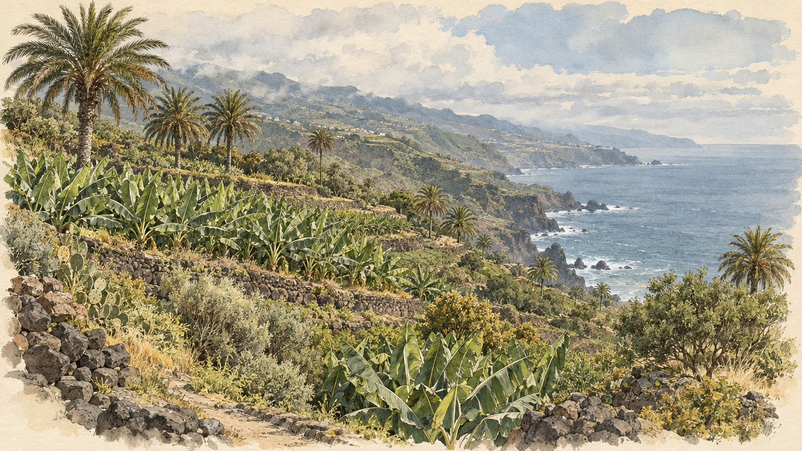
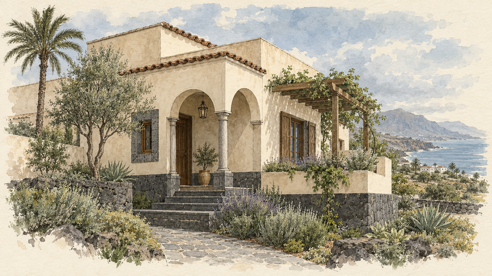
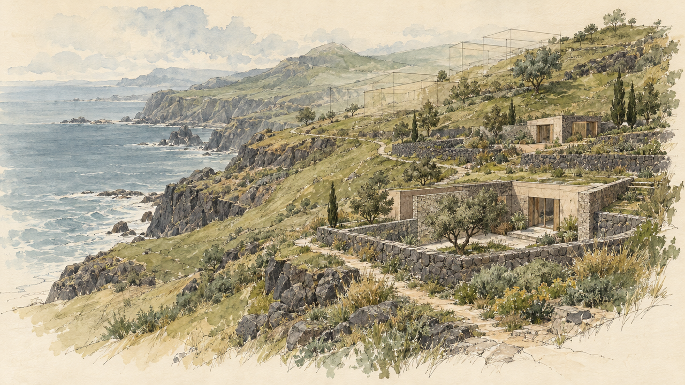
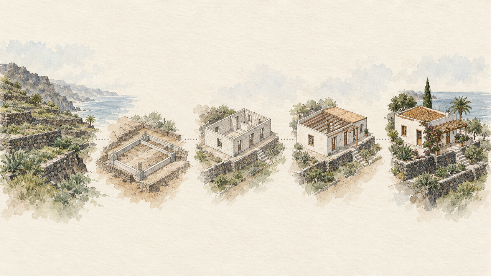
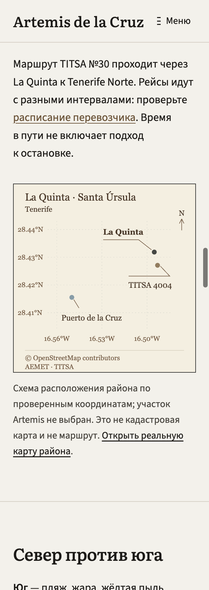

# P0 — эскизы для утверждения, 5 ноября 2026

Все изображения имеют статус **REVIEW**. Это художественные гипотезы, не утверждённый проект и не фотографии участка. Новые четыре эскиза пока не назначены страницам.

Сохранены исходные PNG, SHA-256, настройки генерации, пять alt-текстов и подписей. Каждый эскиз можно утвердить отдельно для указанного назначения. Утверждение изображения не разрешает выпуск сайта.

## ART01 — главная / F01

Ранее подготовленный кандидат. Мобильная версия является черновым кадрированием; самостоятельная композиция 4:5 ещё требуется.

## norte/F21 — wBYf7vERpRPDQRSzObyC

Атмосферный этюд по мотивам севера Тенерифе. Это не съёмка участка и не обещание вида.

Оригинал: 1280×720. Самостоятельная мобильная композиция 4:5 ещё не подготовлена. Права перед публичным использованием требуют подтверждения владельца.

## producto/F05 — MRSkYIdJ4VasJW40dcsx

Архитектурная гипотеза. Планировка, материалы и характеристики ещё уточняются.

Оригинал: 1280×720. Самостоятельная мобильная композиция 4:5 ещё не подготовлена. Права перед публичным использованием требуют подтверждения владельца.

## inversores/F14 — e23JTMG8M8JQCErDMrFw

Поисковый эскиз. Он не подтверждает выбор участка, начало строительства или выполненные работы.

Оригинал: 1280×720. Самостоятельная мобильная композиция 4:5 ещё не подготовлена. Права перед публичным использованием требуют подтверждения владельца.

## construccion/F15 — 7ogqYT3DK47f4vw3nQwc

Концептуальная иллюстрация возможных будущих этапов. Изображения не являются отчётом о ходе работ.

Оригинал: 1280×720. Самостоятельная мобильная композиция 4:5 ещё не подготовлена. Права перед публичным использованием требуют подтверждения владельца.

## Текущий предпросмотр

Проверены 14 типов страниц × 5 языков × 4 ширины (320/768/1024/1440 px): горизонтального переполнения и битых изображений нет; один H1 и один основной CTA на страницу. Это проверка текущего предпросмотра с временно скрытыми слотами, а не будущей установки четырёх кандидатов.

558 тестов: 540 выполнены успешно, 18 пропущены. Отдельно прошли 6 проверок восстановления исполнения.

После утверждения конкретных эскизов: отдельные мобильные композиции, назначение в preview с подписями и проверка размещения. Переход к P1 зависит от завершения P0. Выпуск на действующий сайт согласуется отдельно.
