# P1 — 14 illustrations for named page slots

**Status: REVIEW.** These are new candidates, separate from the five P0 images already approved by the owner. No P1 frame assignments or production publication have been made.

Each original is stored in this branch with SHA-256, dimensions, prompt, approved-family reference and alt/caption text in EN/ES/DE/FR/RU. All 19 desktop concepts (P0 + P1) passed the perceptual uniqueness check: minimum dHash distance 14, duplicate threshold 10.

The architecture, interiors, gardens and solar details remain exploratory concepts. Solar sketches are not approved engineering details or performance evidence.

## 1. index-f04 — index/F04

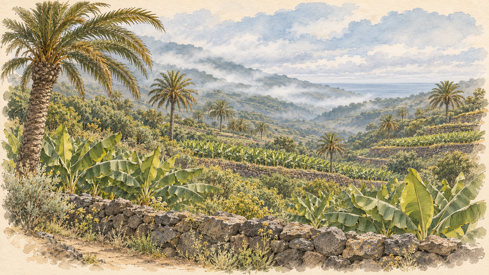

Атмосферный концепт по мотивам севера Тенерифе; это не подтверждённый вид выбранного участка.

Purpose from registry: Зелёный северный ландшафт и атлантическая дымка без гарантированного вида.

Source SHA-256: `5bde8a4f8d908b3dea5c0b601e1d64e20076ec2f7b7e2f411727ff5a0b7b752b`.

## 2. index-f02 — index/F02

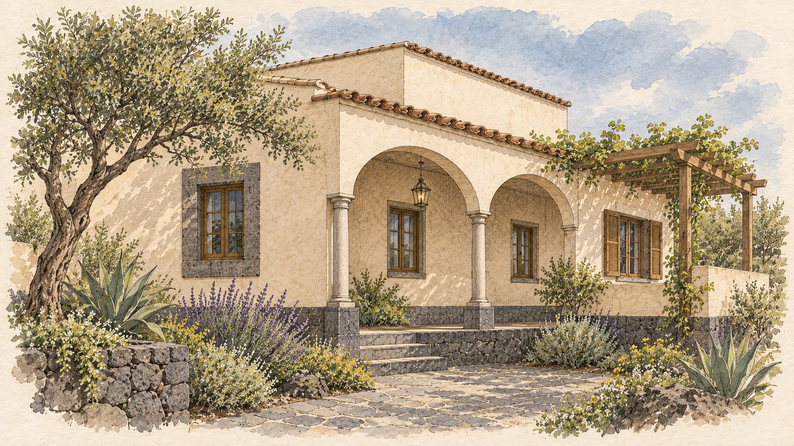

Концептуальный этюд. Дизайн, материалы и характеристики ещё уточняются.

Purpose from registry: Компактный испанско-канарский дом с арочной галереей, базальтом, бронзой, аккуратными колоннами.

Source SHA-256: `3866189e6c6924bb0d0d387e426de6391a5c9d243588ef226b438a53a21f61d4`.

## 3. index-f03 — index/F03

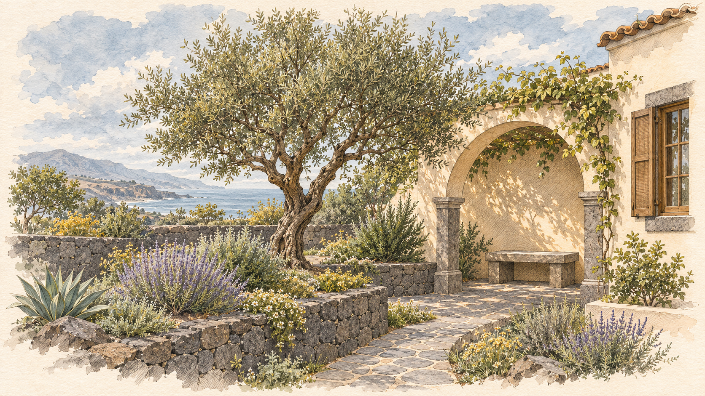

Концептуальный этюд. Дизайн, материалы и характеристики ещё уточняются.

Purpose from registry: Образ приватного сада и общих пространств без обещания утверждённого бассейна.

Source SHA-256: `7e77d56994a4cf08479b66c9b3d735e4489ced5af7d835c8c9a57406d91744ef`.

## 4. norte-f01 — norte/F01

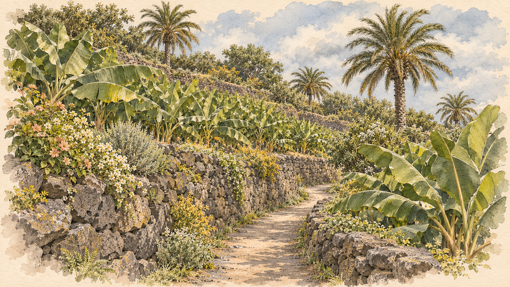

Атмосферный концепт по мотивам севера Тенерифе; это не подтверждённый вид выбранного участка.

Purpose from registry: Характерная зелёная прибрежная среда, путь и склоны; архитектура только как ненавязчивый концепт.

Source SHA-256: `d5af210227a5592c8292ef9c536bc7fb1536a5d0dc2514956fbb9ade34fbf38d`.

## 5. producto-f06 — producto/F06

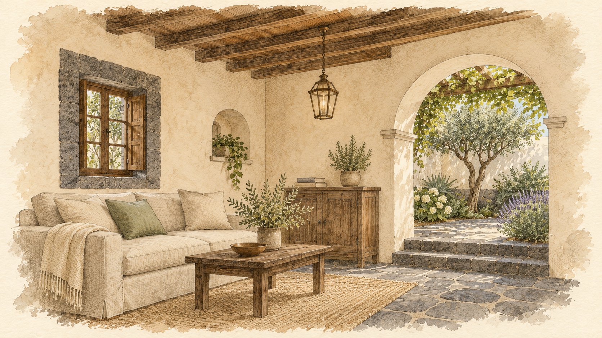

Концептуальный этюд. Дизайн, материалы и характеристики ещё уточняются.

Purpose from registry: Эскиз жилой комнаты как исследование приватного масштаба.

Source SHA-256: `863e286717aad12bf9c788748b25c1bf42eca01605edb37df0c99a07cd59da0f`.

## 6. producto-f07 — producto/F07

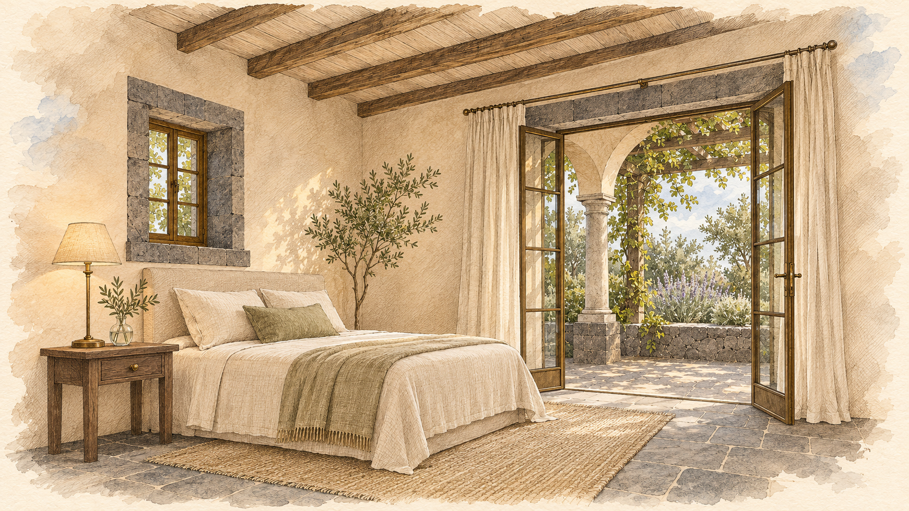

Концептуальный этюд. Дизайн, материалы и характеристики ещё уточняются.

Purpose from registry: Спальня / лоджия в акварели без гарантированного вида на океан.

Source SHA-256: `d87cbf5a2922372ce974a07d41e89cd6e927fa5d106ef1cd8e47c163ee3dfb21`.

## 7. producto-f08 — producto/F08

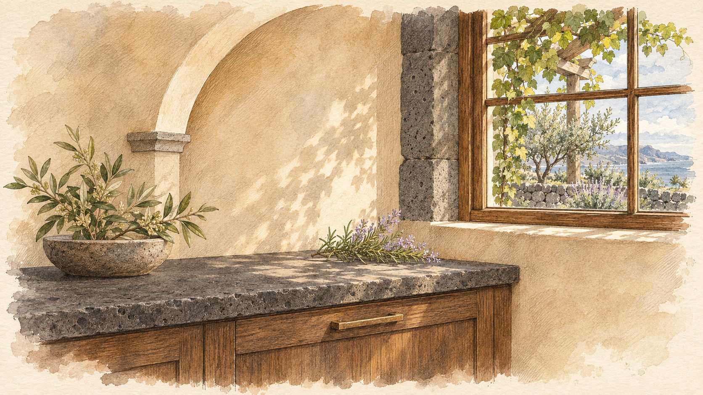

Концептуальный этюд. Дизайн, материалы и характеристики ещё уточняются.

Purpose from registry: Камерный интерьер с канарским базальтом, кремовой штукатуркой, бронзой.

Source SHA-256: `3d632e32ec247301c050a18e66358020b37c86634f74f875efec044cd5a77046`.

## 8. alquiler-f10 — alquiler/F10

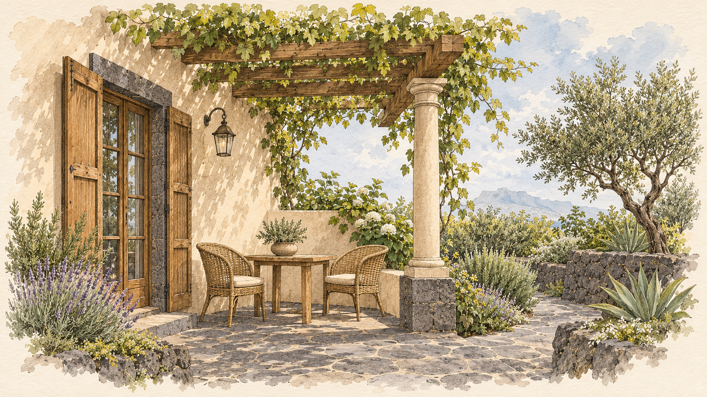

Концептуальный этюд. Дизайн, материалы и характеристики ещё уточняются.

Purpose from registry: Камерная терраса, испанская колонна, зелёный сад, приглушённая Атлантика.

Source SHA-256: `84ce1a05874d843a0b20d5ab7395fc1b91174523474573ce7a9bd9614c41faca`.

## 9. energia-f11 — energia/F11

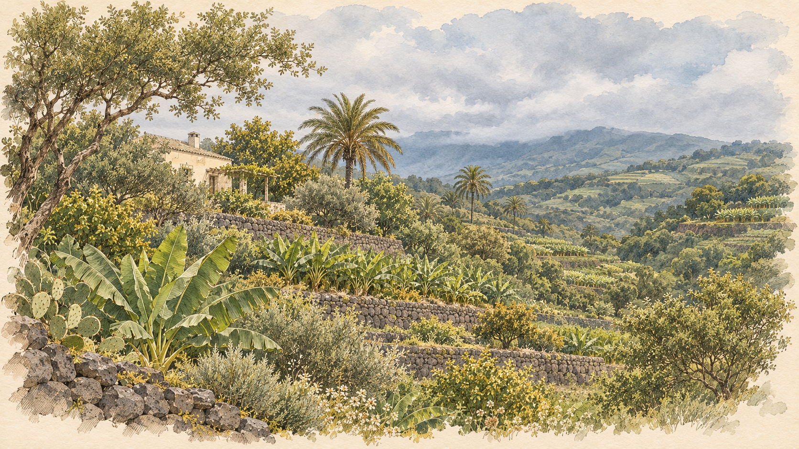

Концептуальный этюд. Дизайн, материалы и характеристики ещё уточняются.

Purpose from registry: Зелёный северный склон и архитектура как возможный экологичный ансамбль.

Source SHA-256: `8fbbc54e8c1f048549f82239f51e1afff06715e4dabf4b16edf10dcd085556bd`.

## 10. energia-f13 — energia/F13

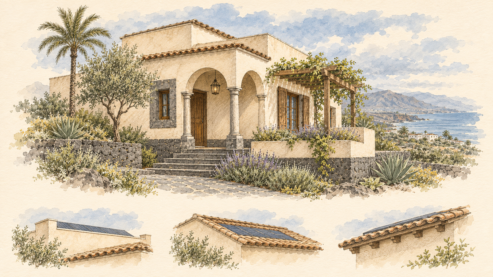

Иллюстрация возможного решения, а не утверждённый инженерный узел или обещание производительности.

Purpose from registry: Варианты незаметной интеграции солнечных панелей в концептуальную кровлю.

Source SHA-256: `8e6e9f64ad8700c34583e3e892ca2b8cacbaf6fcd00c0d09f4c7d6a60fce7fef`.

## 11. energia-f16 — energia/F16

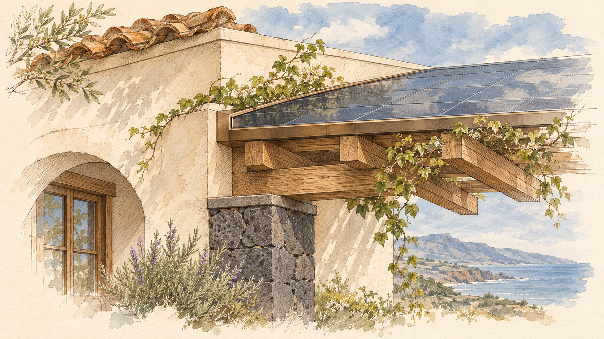

Иллюстрация возможного решения, а не утверждённый инженерный узел или обещание производительности.

Purpose from registry: Концептуальный узел панели, стропильной/кровельной системы и инженерии, не фото монтажа.

Source SHA-256: `66443ea5ccfc7c759c40666c897313d6edb450110537dd28b9a6a6ebaae945a7`.

## 12. proceso-f02 — proceso/F02

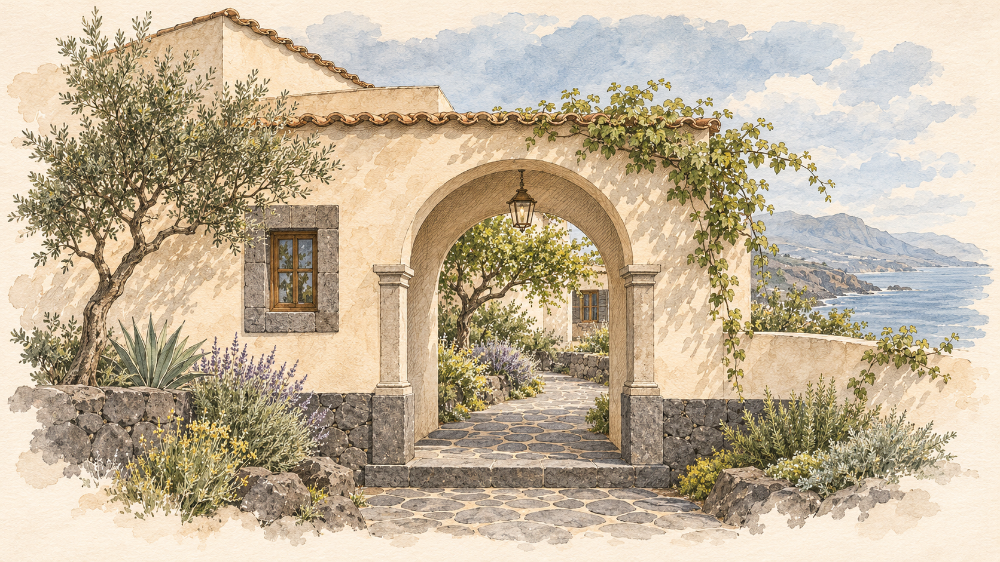

Концептуальный этюд. Дизайн, материалы и характеристики ещё уточняются.

Purpose from registry: Сдержанная архитектурная арка-переход как символ начала проекта, без обещания готовых ворот.

Source SHA-256: `25ad3f02be32996d91ce2c1a498e91c747c21c868e63eab9ddd522fa78cc922f`.

## 13. mercado-f24 — mercado/F24

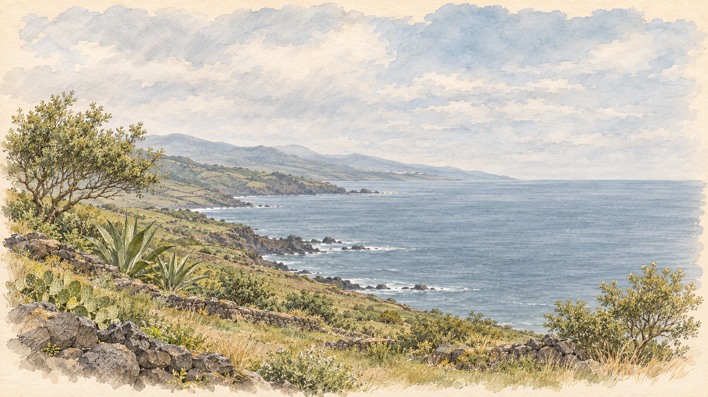

Атмосферный концепт по мотивам севера Тенерифе; это не подтверждённый вид выбранного участка.

Purpose from registry: Атлантический ландшафт с очень условным силуэтом поселения, без рекламного заката.

Source SHA-256: `f8cf50e3406745d016a299c45ec2d7b6da9e33ef896dde9bb4ca7c49d3fb9859`.

## 14. boris-f18 — boris/F18

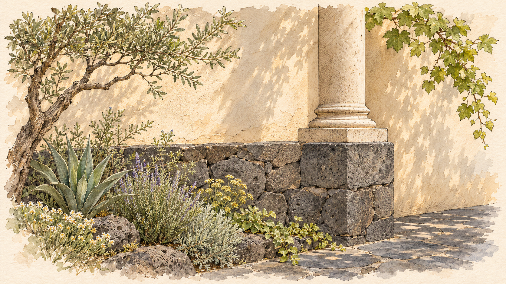

Концептуальный этюд. Дизайн, материалы и характеристики ещё уточняются.

Purpose from registry: Небольшой архитектурный этюд материалов / общего сада, без демонстрации готового бассейна.

Source SHA-256: `ee554c0323100a470b409624760ebd579dcadb9ed18b87b4bb62a3e72e69b271`.

## Approval scope

Approval means use of the named image for its named slot, necessary responsive adaptation, and placement in the review preview. It does not approve a final architectural design, technical specification, investment claim or production release.

Hero candidates for alquiler, energia and mercado need their own portrait adaptations after selection. Detailed roof studies must remain readable without cropping. Financial diagrams remain outside this artwork approval and depend on the verified financial model.
